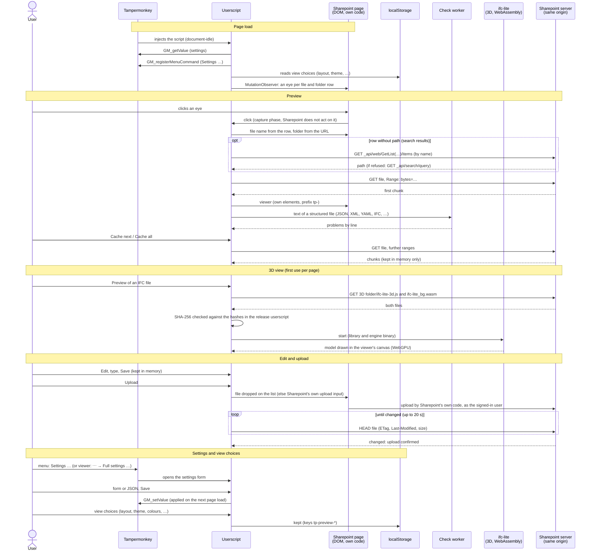

# Sharepoint Previewer - Notes for review #

A userscript (Tampermonkey)
that adds a preview column to Sharepoint Online document libraries
and shows files in the browser,
including files Sharepoint itself cannot preview.

This document is for reviewing the script before it is installed or deployed:
what it does and does **not** do,
which network requests it makes,
where it stores data,
and how it can be deployed.
Development: [TECHNICAL.md](TECHNICAL.md).

---

## 1. Summary ##

| Topic | Behaviour |
| :---- | :-------- |
| Form | One JavaScript file (userscript, ~530 KB; minified ~295 KB), runs in the user's browser via Tampermonkey. Built from TypeScript modules in the repository (types removed by the build) |
| Scope | Only on `https://*.sharepoint.com/*/*/*`, and only inside a library's file list |
| APIs | No Graph API. It reads the page's HTML and fetches the file itself, like opening its URL. Only for files found by the library search (their rows carry no path): two read-only Sharepoint REST queries by file name (library list, else search index) |
| Third parties | **None.** No CDN, no analytics, no external servers. All requests go to the same Sharepoint origin |
| External libraries | None loaded at runtime. The script contains a port of Microsoft's XPress9 decoder (MIT), to read the queries of newer Power BI files in the browser. Optional 3D view: two files (ifc-lite, MPL-2.0) that **you** host in your own Sharepoint |
| Permissions | Those of the signed-in user, through the browser's normal session. No extra rights, no tokens |
| Data leaving the browser | Only when the user explicitly uploads a file (edited, new, or a renamed copy), through Sharepoint's own upload (as if done by hand) |
| Storage | Settings in Tampermonkey's script storage. View choices and window positions in the browser's `localStorage` for the Sharepoint origin. File contents only in memory, gone on reload |
| Cookies | Not used |
| Tampermonkey grants | `GM_getValue`, `GM_setValue`, `GM_registerMenuCommand` (settings only) |

---

## 2. What it does ##

- **Eye column** at the far left of every file and folder row in a document library:
  one click opens a viewer next to the list (below, right of it, or as a pop-up).
- **Viewer:** shows text-like files, CSV, Parquet, spreadsheets, Markdown and IFC models
  in the browser, read from the file itself (formats: [TECHNICAL.md](TECHNICAL.md#supported-formats)).
- **Editing:** plain-text files can be edited;
  an upload goes through Sharepoint's own upload, as the signed-in user (§3).
- **Sharepoint's own UI is not changed,**
  apart from the eye column and the room for the viewer.
  Lists inside dialogues and pop-ups (e.g. "Copy to") are left alone,
  and nothing depends on the UI language.
- **File identification:**
  - the file name is read from the row's HTML
  - the folder comes from the browser URL (`id=` parameter or library path)
  - in search results, the path is taken from the row's own link,
    else looked up by name below the open folder (§4)
- **Nothing else from the list is read.**
  No column values, no hidden data.

What it looks like: [demos](demos/README.md).

---

## 3. Communication ##

Who talks to whom, from page load to upload
(requests: §4; storage: §5).
All requests go to the Sharepoint the page comes from, nowhere else.

---

## 4. Network behaviour (complete list) ##

All requests use `fetch` with `credentials: 'same-origin'`
and are **refused by the script if the target is not the current Sharepoint origin**.

| Request | When | Purpose |
| :------ | :--- | :------ |
| `GET <file>` with `Range: bytes=…` | Opening a file; "Cache next"; "Cache all" | Read the file in chunks (default 512 KB). If Sharepoint ignores ranges, one transfer is kept paused between chunks |
| `GET <file>` `Range: bytes=0-3` | Opening a Parquet file | File size; then footer and needed column chunks by range |
| `GET <file>` (whole) | Opening an `.ifczip` (after confirmation if > chunk size) | ZIP archive, unpacked in the browser |
| `GET <file>` `Range: bytes=0-7`, then further ranges | Opening a spreadsheet; choosing another sheet; "Cache next sheet" | Size and signature; then only the parts needed: ZIP directory, workbook, shared strings, styles and the sheet shown (`.xls`: the sectors of the workbook globals and of that sheet) |
| `GET <target>` | Opening a `.url` link file | Follows the link, same origin only, max. 5 hops |
| `GET <site>/_api/web/GetList(…)/items`, if refused `GET <site>/_api/search/query` | Opening a file from search results in a library (rows there carry only the name) | Finds the file's path below the open folder, by name: library list first, search index as fallback |
| `HEAD <file>` | After an upload | Checks that the file really changed (ETag / Last-Modified / size) |
| `GET <VIEWER_3D_FOLDER>/ifc-lite-3d.js`, `…/ifc-lite_bg.wasm` | First use of the 3D view only | 3D library from **your** Sharepoint; checked against fixed SHA-256 hashes before use |

There are no other requests:
no telemetry,
no update checks
and no fonts or images from outside.
The logo setting only accepts `data:` URIs.

---

## 5. Data handling and storage ##

| What | Where | Lifetime |
| :--- | :---- | :------- |
| File contents (cached chunks) | JavaScript memory of the tab | Until reload, "Clear cache", or eviction at the cache limit |
| Settings (cf. [TECHNICAL.md, Settings](TECHNICAL.md#settings)) | Tampermonkey storage for this script | Until changed / reset / script removed |
| View choices (layout, split size, theme, colours, wrap, text size, table / Markdown / 3D on/off, properties lines, CSV format, sheets or tables per spreadsheet path) and window positions | `localStorage` of the Sharepoint origin, keys `tp-preview-*` | Until the user clears site data |
| 3D camera per file | Memory | Until reload |

- **Cache limit:**
  all cached files together are limited (default 256 MB).
  - If the cache is full,
    opening another file asks first (OK / Cancel)
    whether to clear the other cached files.
  - Files still caching in the background
    and the file on screen are never cleared.
- **Memory use:**
  text uses roughly twice its file size in the browser's memory.

---

## 6. Security assessment ##

### Risk reduction ###

- **No new attack surface on the server side:**
  - no API usage
  - no server component
  - no app registration
  - no extra permissions (only the user's existing session)
- **Same origin only:**
  every fetch target is checked against `location.origin`.
  Link files are not followed to other sites.
- **No third-party code at runtime:**
  the optional 3D library is hosted by you
  and verified by SHA-256 before it is executed.
- **No data leaves the browser**
  except through a user-initiated upload to the same Sharepoint.
- **HTML escaping:**
  file contents are always escaped before they are put into the page.

### For further consideration ###

- **Userscripts run with access to the page.**
  Any userscript manager can, in principle, read what the user sees.
  Trust therefore depends on reviewing this file and controlling its distribution
  (pin the version, disable auto-update from untrusted URLs).
- **3D view:**
  - It runs the ifc-lite bundle with `new Function(...)` and compiles WebAssembly.
  - Sharepoint's Content Security Policy (CSP) could block this in future.
    The script then shows "3D view failed"
    and everything else keeps working.
  - It needs WebGPU (current Chrome / Edge).
- **Checks run in a Web Worker**
  created from a `blob:` URL, built from the script's own code.
  If workers are blocked, checks run on the page instead.
- **Upload simulation depends on Sharepoint's UI** (drop target / file input).
  Changes by Microsoft may break it;
  the script then offers a local save instead.
- **DOM dependence:**
  the eye column relies on Sharepoint's ARIA roles
  (`role="grid"`, `row`, `columnheader`, `gridcell`).
  Microsoft UI changes may require adjustments.

---

## 7. Deployment options ##

1. **Per user:**
   install Tampermonkey (Chrome / Edge),
   then install the script.
   Suitable for pilots.
2. **Managed:**
   - Deploy Tampermonkey through browser policy
     (Edge / Chrome extension allow-list / force-install).
   - Provide the reviewed script from an internal location.
   - Keep auto-update pointed only at that internal URL.
3. **3D view (optional):**
   - Put `ifc-lite-3d.js` (~1 MB) and `ifc-lite_bg.wasm` (~10 MB)
     into a Sharepoint library readable by the users.
   - Set `viewer-3d-folder`.
   - The script contains the expected SHA-256 hashes;
     files that don't match are refused.
   - Source of the bundle:
     `@ifc-lite/geometry`,
     `@ifc-lite/renderer`,
     `@ifc-lite/wasm`
     (versions pinned in `package.json` of the release),
     bundled with esbuild into one file
     that only exposes `globalThis.IfcLite`.
   - The `.wasm` file is the unchanged engine binary published in `@ifc-lite/wasm`.
   - Both files are delivered with each release of the script.
     The script only accepts the 3D files of its own release (SHA-256),
     so the script and the 3D files are always deployed together.

**Long-term alternative:**
if a permanent solution without a userscript manager is preferred,
the same logic could be ported to an SPFx extension
(list view command set / field customiser).
That is outside the scope of this script.

---

## 8. Limitations and status ##

- **Platform:**
  Sharepoint Online (modern library view); Chrome and Edge.
  The 3D view needs WebGPU.
- **Not supported:**
  - Word and PowerPoint files
  - editing spreadsheets (read only);
    their charts, images, comments and cell formatting (colours, merged cells)
  - Excel 2.x–4.x files and encrypted workbooks
  - Parquet nested types beyond simple lists
  - ZIP archives other than IFCZIP and spreadsheets
- **Dates:**
  the modified date comes from the HTTP response of the file.
  Sharepoint may report the time the file was served
  rather than when it was last changed.
- **Testing:**
  - Every module of the script has unit tests outside the browser
    (decoders for Parquet, Snappy, LZ4, ZSTD and spreadsheets, linters, highlighters, cache, …).
  - The spreadsheet reader was also checked against the public test files of
    the calamine library (~150 real-world workbooks).
  - The UI was tested in Chromium against a mock of Sharepoint's markup
    and by hand in Sharepoint Online.
  - Upload and 3D rendering were tested by hand only.

---

## 9. Credits and licences ##

- **The script:**
  written for this purpose, apart from the XPress9 decoder (ported from Microsoft's sources, MIT; its notice kept in that file);
  licence: MPL-2.0, see `LICENCE` in the repository
  (also named in the script's header: `@copyright`, `@license`).
- **Tampermonkey** (<https://www.tampermonkey.net>, by Jan Biniok):
  browser extension that runs the script;
  installed separately, not distributed with the script.
- **Optional 3D bundle:**
  IFClite by Louis Trümpler & contributors (LTplus AG), **MPL-2.0**
  (<https://ifclite.dev>, source code: <https://github.com/LTplus-AG/ifc-lite>).
  Used unchanged, as permitted.
  Modified IFClite source files would have to stay under MPL-2.0.
