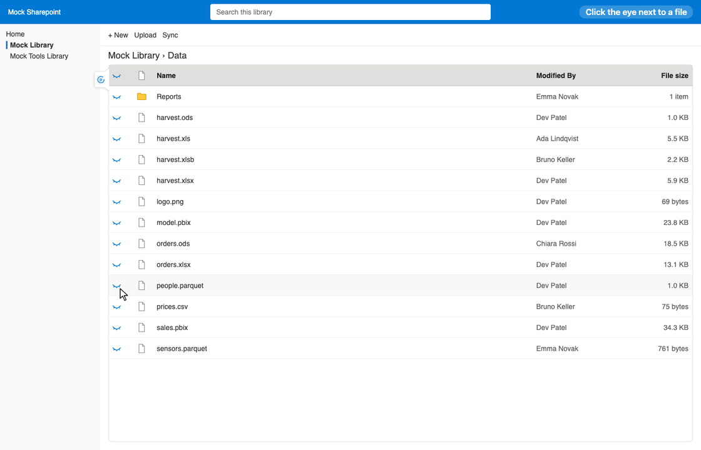

# Sharepoint Previewer #

It goes without saying: _Microsoft Sharepoint is frustrating_.
So we set out to solve one very simple problem:
users should _at bare minimum_ be able to preview plaintext files – regardless of their file extensions!

We set out to build a **previewer** that simply augments the Sharepoint experience to overcome just this issue.

## Demonstration ##

See the [demos](demos/README.md):
screenshots and the logic of each part
(list view, layouts, Zen mode, title bar, text, tables, 3D, editing, caching, settings).

For reviewing the script (permissions, network, storage, security, deployment):
see [NOTES.md](NOTES.md).

## Motivation ##

### What? ###

This repository produces a userscript
to preview (text, table, 3D, spreadsheets) and edit files in Sharepoint libraries.
It runs in the browser extension [Tampermonkey](https://www.tampermonkey.net)
(cf. [Credits and licences](#credits-and-licences)).

### Why? ###

After further consideration we built further features into this application.
Our tool allows users to

- preview any text file, with syntax colours and checks (JSON, XML, YAML, IFC, ...)
- view CSV, Parquet, Excel and OpenDocument files as sortable, filterable tables
- look into Power BI files (parts, Power Query scripts and parameters)
- read Markdown rendered and logs as tables (experimental)
- view IFC models in 3D (optional)
- edit plaintext files, or create new ones, and save them back through Sharepoint's own upload (also under another name)
- work in **Zen mode**: an own list of the folder beside the viewer, with frozen names and column titles, sorting, filters, a layout mode to show, hide and move columns (widths: any time), files and folders selected, downloaded (a ZIP) and deleted (to the recycle bin, or purged for good; after asking), and an edit mode for properties and names in place

> [!NOTE]
> Our tool involves no third-party code, except the optional 3D view built on [IFClite](https://ifclite.dev).
> Only Zen mode and the lookup of search results use Sharepoint's own REST API (same site, your session);
> the setting `sharepoint-api` switches every use of the API off.

### For whom? ###

This application is design for people who use Sharepoint in a browser.
e.g. engineers checking models and exports,
data and BI people looking into tables,
developers and admins reading logs and configs,
and IT teams who want all this without another app to roll out.

## Installation and usage ##

Quick start:

1. Install the browser extension [Tampermonkey](https://www.tampermonkey.net) (with user scripts enabled).

2. Add `sharepoint-previewer.min.js` from the [releases](../../releases) to Tampermonkey.

3. Open a Sharepoint library and click the eye next to a file.

Details (requirements, the optional 3D view, settings, setup for developers): [INSTALL.md](INSTALL.md).
The controls that are hard to discover are listed in the script itself: Tampermonkey menu → "About …" (or ⋯ → "About …").

## Notes ##

- See [INSTALL.md](./INSTALL.md) for installing and first steps.
- See [NOTES.md](./NOTES.md) for reviewing the script: permissions, network, storage, security, deployment.
- See [TECHNICAL.md](./TECHNICAL.md) for development: repository, build, tests, and the logic inside (formats, caching, editing, settings).

## Credits and licences ##

- **This script:**
  written for this purpose, apart from the XPress9 decoder below;
  licence: [MPL-2.0](./LICENCE) (Mozilla Public License 2.0):
  use, change and pass on freely, also commercially;
  the copyright and licence notices stay,
  and changed files of this project stay under MPL-2.0 (their source available to whoever receives them).

- **XPress9** by Microsoft Corporation, **MIT**:
  the decompression of Power BI data models
  ([/src/readers/codecs/xpress9.ts](./src/readers/codecs/xpress9.ts))
  is ported from Microsoft's XPress9 sources (decoder only),
  as published with [xpress9-python](https://github.com/Hugoberry/xpress9-python);
  its copyright and licence notice is kept at the top of that file.

- **[Tampermonkey](https://www.tampermonkey.net)** by Jan Biniok:
  the browser extension that runs the userscript.
  Each user installs it separately;
  it is neither part of nor distributed with this repository.

- **[IFClite](https://ifclite.dev)** by Louis Trümpler & contributors (LTplus AG), **MPL-2.0**:
  the engine of the optional 3D model-viewer.
  - The release bundles `@ifc-lite/geometry`, `@ifc-lite/renderer` and `@ifc-lite/parser` (with their dependencies) into `ifc-lite-3d.js`
    and ships the engine binary of `@ifc-lite/wasm` unchanged as `ifc-lite_bg.wasm`;
    versions pinned in [package.json](./package.json).
  - Used unchanged; its source code is available at <https://github.com/LTplus-AG/ifc-lite>.
    Modified IFClite source files would have to stay under MPL-2.0.

- **Development only** (not part of the userscript):
  [TypeScript](https://www.typescriptlang.org),
  [Biome](https://biomejs.dev),
  [esbuild](https://esbuild.github.io),
  [Playwright](https://playwright.dev),
  the test file `Data/model.pbix` from the samples of [PBIXRay](https://github.com/Hugoberry/pbixray) (MIT),
  [just](https://just.systems).

Microsoft, Sharepoint, Tampermonkey and other names are trademarks of their respective owners;
this project is not affiliated with or endorsed by them.
