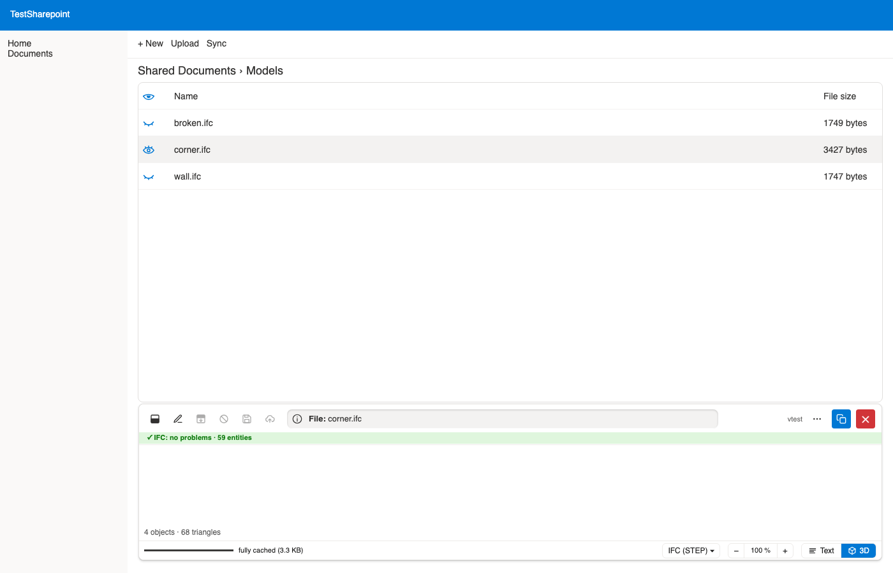

# Demo: 3D #

IFC models open in an optional 3D view (ifc-lite),
once the two 3D files of a release are deployed to a SharePoint folder
(setting `viewer-3d-folder`).

The screenshot shows the mock SharePoint of the tests
(`/tests/mocks/mock-sharepoint`),
written by `just demos` after `just build`.

[Back to the README](../README.md)
