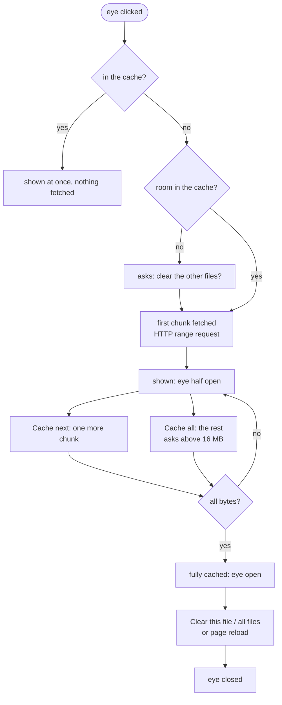
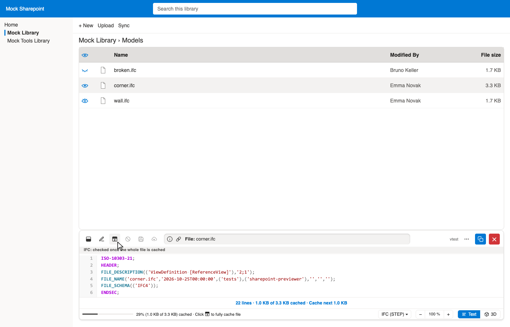
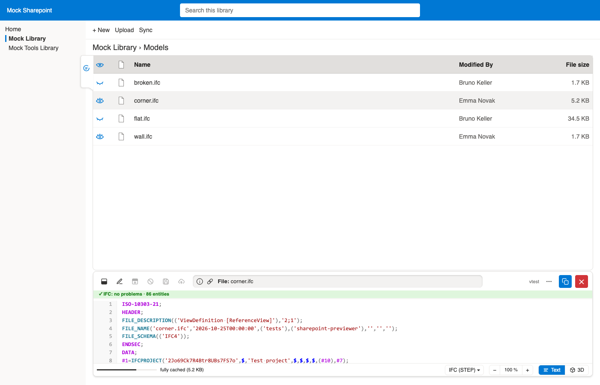

# Demo: Caching #

All screenshots show the mock Sharepoint of the tests
(`/tests/mocks/mock-sharepoint`),
written by `just demos`
(with chunks of 1 KB, so that the small test files are cached in parts;
the default is 512 KB, setting `cache-chunk-bytes`).
Details: [NOTES.md, §7](../NOTES.md#7-caching-logic).

## Logic ##

- Contents stay in the tab's memory only (nothing on disk), up to 256 MB for all files (setting `memory-cache-bytes`).
- Big Parquet and IFCZIP files (more than one chunk) are fetched only on request.
- A running "Cache all" goes on in the background when another file is shown; the stop button cancels it.

## Partly cached ##

The first chunk is shown at once.
The bar below the text fetches the next chunk;
the button in the header (or the hint in the status bar) fetches the rest.
In the list, the eye is half open (here: `corner.ifc`; `wall.ifc` is fully cached).

## Fully cached ##

Once every byte is there, the status bar says "fully cached" and the eye is open.
Opening the file again fetches nothing.

[Back to the demos](README.md)
