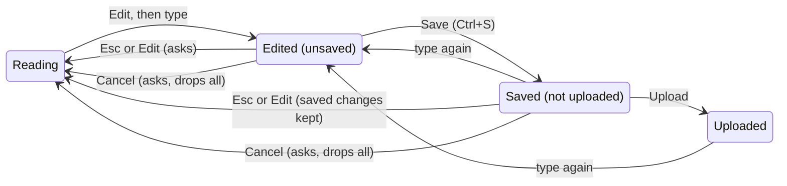
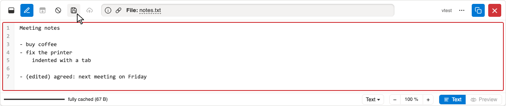
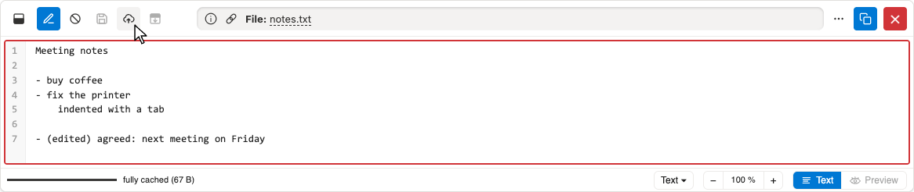
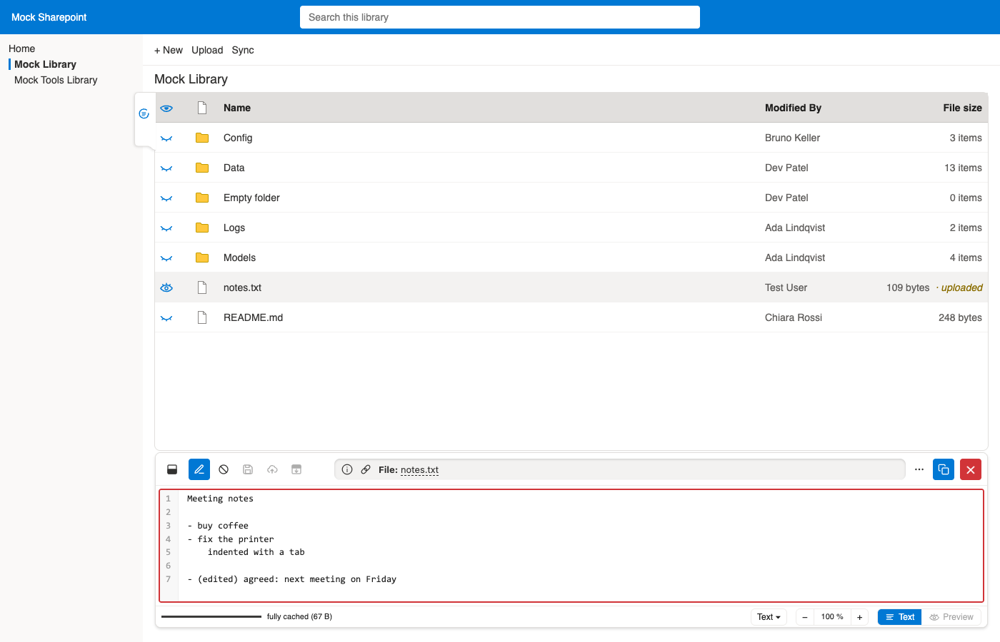

# Demo: Editing #

All screenshots show the mock Sharepoint of the tests
(`/tests/mocks/mock-sharepoint`),
written by `just demos`
(uploads simulated: kept apart, the test files stay untouched).
Details: [NOTES.md, §8](../NOTES.md#8-editing-and-upload).

## Logic ##

- **Save** keeps the edits in the browser only; **Upload** hands the saved text to Sharepoint,
  the way a user would (dropped on the list), then a check confirms the new file.
- **Esc** only leaves edit mode (as the edit button); Esc again closes the viewer.
- **Cancel** drops all changes not uploaded yet (saved ones too), after asking.
- Switching files, closing the viewer or leaving the page with changes not uploaded asks first.
- Another name (click the file name in edit mode): cf. [Title bar](title-bar.md).

## Edited ##

Edit mode frames the text in red; Save is enabled once the text changed.

## Saved ##

Saved: Upload is enabled (Save again once the text changes).

## Uploaded ##

Sharepoint has the new text (in the list: uploaded by the test user);
the viewer stays in edit mode for further changes.

CSV files can also be edited in the table: cf. [Tables and spreadsheets](tables.md).

[Back to the demos](README.md)
