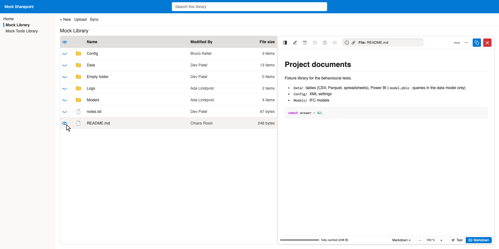
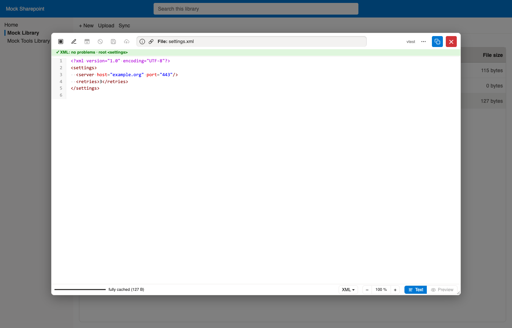
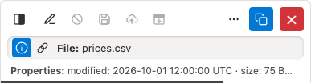
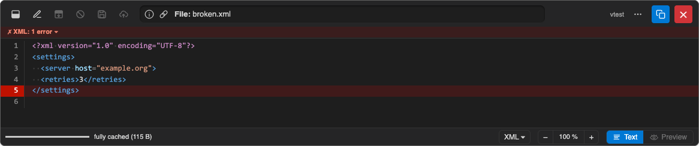
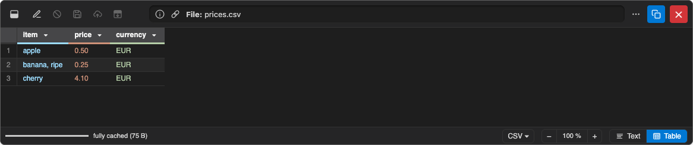
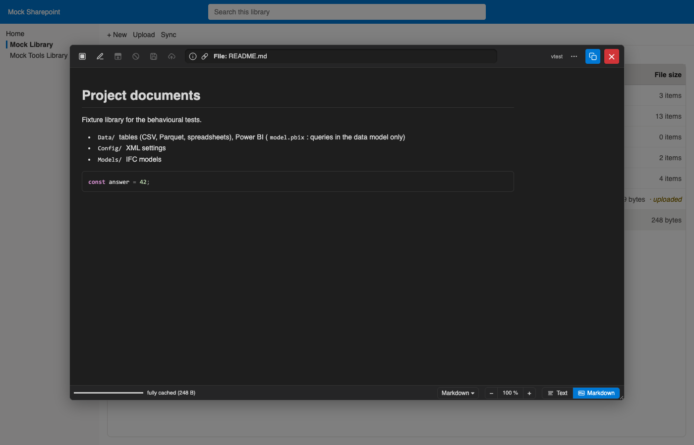

# Demo: Layouts and dark mode #

All screenshots show the mock Sharepoint of the tests
(`/tests/mocks/mock-sharepoint`),
written by `just demos`.

## Layouts ##

The viewer sits below the list
(cf. [List view and search](list.md)),
right of the list,
or in a movable pop-up (layout button, top left of the viewer).

The pop-up can be resized at its lower right corner (its size is kept, like its position).
A narrow viewer puts the file name on a second row.

## Dark mode ##

⋯ → Dark mode (or the setting `theme`) switches the viewer to dark colours;
the choice is kept.

[Back to the README](../README.md)
