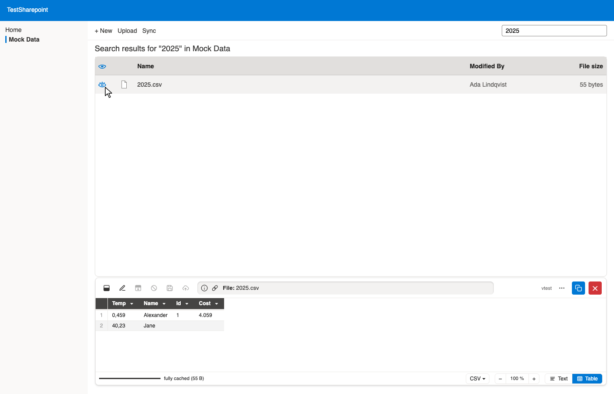

# Demo: List view and search #

All screenshots show the mock Sharepoint of the tests
(`/tests/mocks/mock-sharepoint`),
written by `just demos`.

## List view ##

Each file and folder in the library gets an eye.
One click opens the preview next to the list,
without downloading the file or leaving the page.

## Search results ##

Files found by the library search carry no path in Sharepoint's list.
The previewer looks them up by name below the folder open
and shows them from where they are.

[Back to the README](../README.md)
