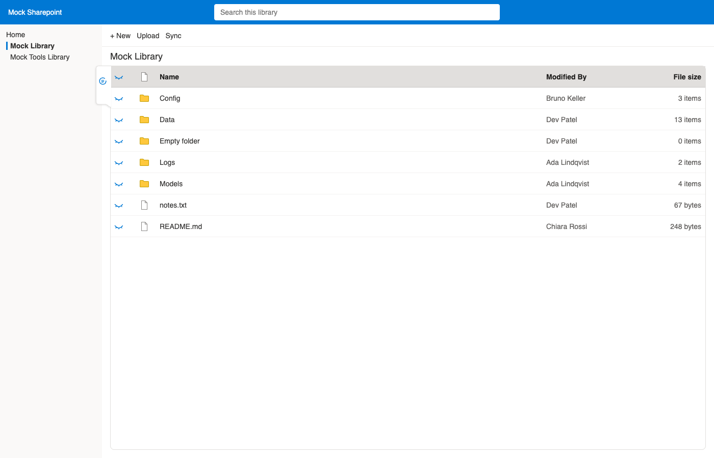
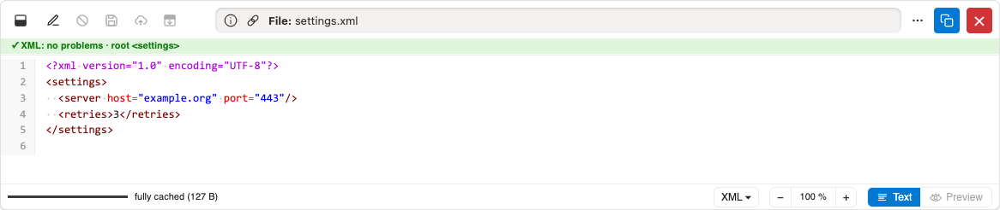
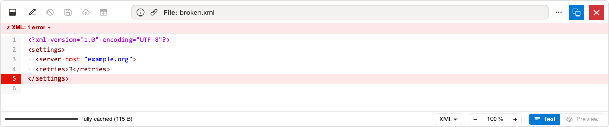
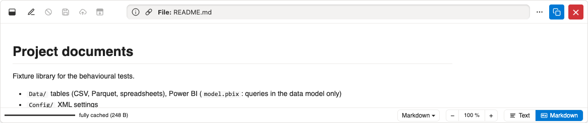

# Demo: Overview #

All screenshots show the mock SharePoint of the tests
(`/tests/mocks/mock-sharepoint`),
written by `just demos`.

## List view ##

Each file in the library gets an eye.
One click opens the preview next to the list,
without downloading the file or leaving the page.

## Text ##

Plain text files open as text,
with syntax colours and line numbers.

## Syntax check ##

Structured files (JSON, XML, YAML, IFC, ...) are checked on opening.
Errors are summarised and marked in the text.

## Markdown ##

Markdown files are rendered;
**Text** shows the source.

[Back to the README](../README.md)
