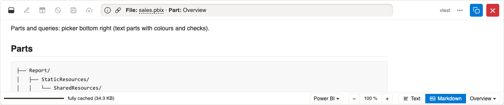
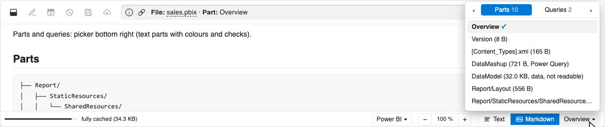
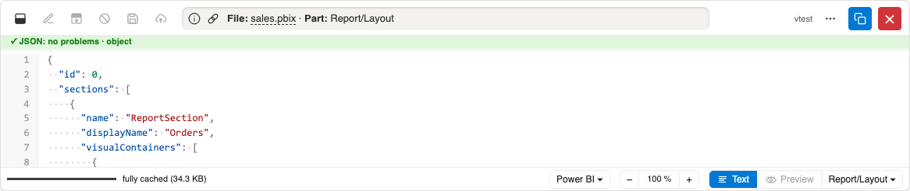
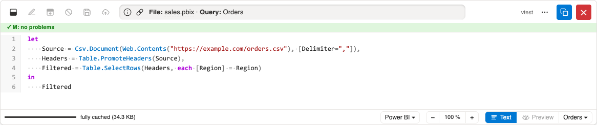

# Demo: Power BI #

All screenshots show the mock Sharepoint of the tests
(`/tests/mocks/mock-sharepoint`),
written by `just demos`.

## Overview ##

Power BI files (`.pbix`, `.pbit`, `.pbiviz`) open with an overview:
the parts of the file as a tree (with sizes),
the Power Query parameters as a table
and the queries with syntax colours.

## Parts and queries ##

The picker next to **Markdown** lists the parts and the queries side by side (← → in the menu).
Parts without text (data model, images) are listed, but not shown.

A part is shown in its own format, read only, with colours and checks:
JSON, XML or Power Query M (recognised from its start if it has no extension).
JSON is indented, and JSON held in strings (e.g. `config` in `Report/Layout`) is unpacked.

Each query on its own:

## Logic ##

- The file is read by range: the archive's directory, then its parts (each up to 16 MB), all at once;
  the data model is never fetched.
  Choosing another part needs no further requests.
- Above 25 MB of parts to read (setting `powerbi-confirm-bytes`) the viewer asks first.
- Queries come from `DataMashup` (`.pbix`) or `DataModelSchema` (`.pbit`).
  Newer files may keep their queries only in the data model: the overview then says so.
- Reports, visuals and data are not shown.

[Back to the demos](README.md)
