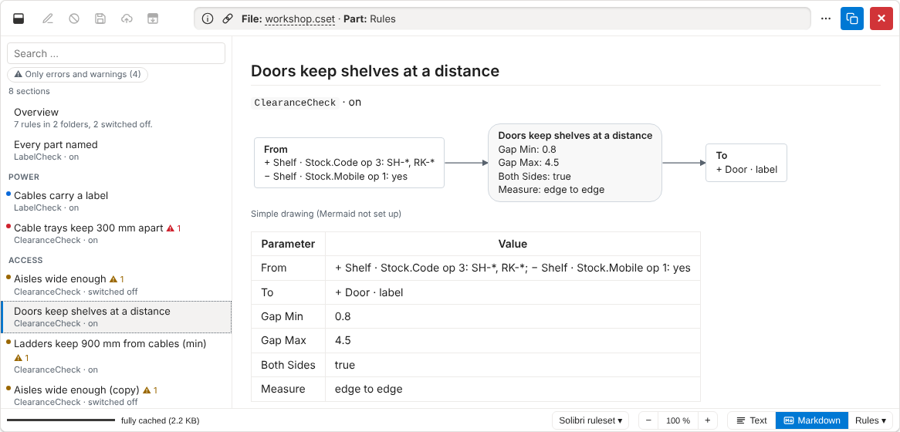
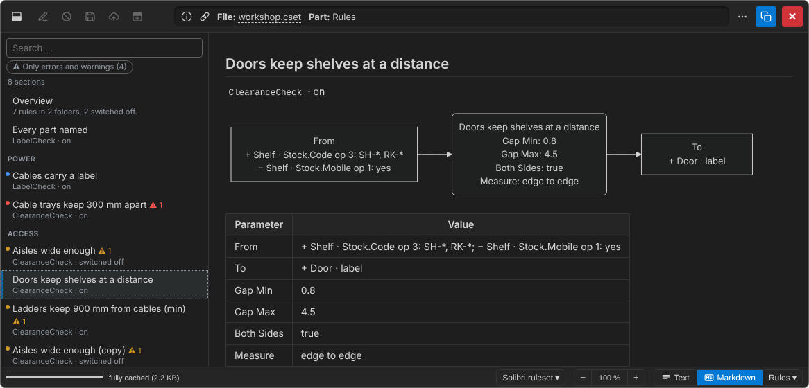
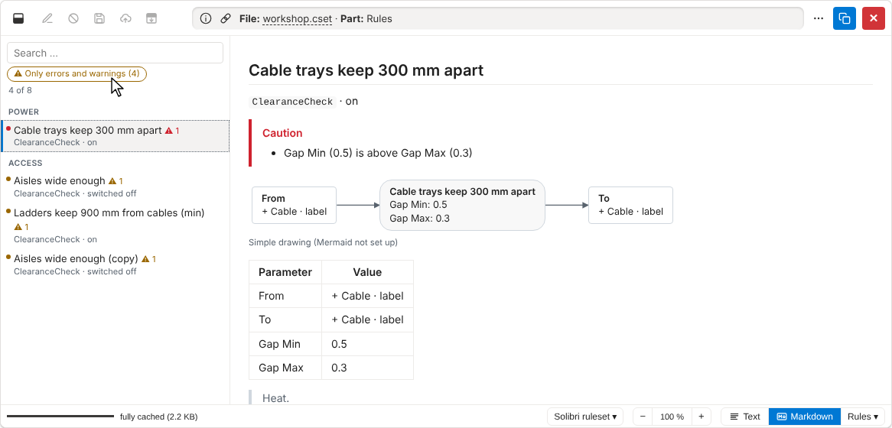
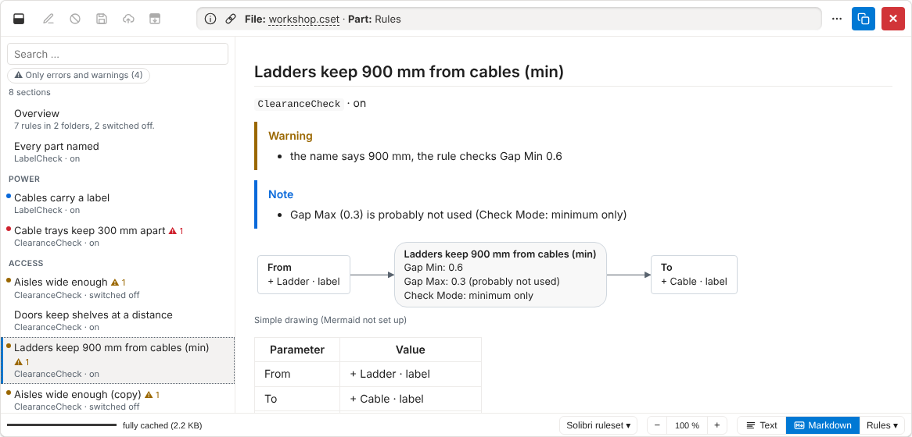

# Demo: Solibri rulesets #

All screenshots show the mock Sharepoint of the tests
(`/tests/mocks/mock-sharepoint`),
written by `just demos`.
The ruleset shown (`workshop.cset`) is made up: a workshop with shelves, doors, ladders and cables.

## Rules one by one ##

Rulesets (`.cset`) stored as Java objects open on the part **Rules**:
the rules on the left, grouped by folder, with a search field (all words, in names and text);
↑ / ↓ / Home / End go through them, Esc clears the search.
Each rule shows a diagram (component filters into the rule, filters "to" out of it, its values),
a table of all its values and its explanation; previous / next at the end.

Without the diagram file the viewer draws the diagrams itself (simple flowcharts):

With `mermaid.js` in the viewer files folder, [Mermaid](https://mermaid.js.org) draws them (here in dark mode);
**Copy** (on hovering a diagram) gives its Mermaid text.

## Hints ##

The viewer compares the values of the rules and marks what looks odd,
in three levels: error (red), warning (amber), info (blue).
A dot on each rule in the list has the colour of its highest level;
**Only errors and warnings** filters the list.

A warning (the name says 900 mm, the rule checks 0.6 m) and an info:
a value the check mode probably ignores, also marked in the diagram and the table.

## Logic ##

- The whole file is read once (up to 64 MB), in any form: XML or Java objects, plain, zipped or gzipped.
- Rules are recognised by the fields of the objects, not by Solibri's class names.
- Hints come from the values alone: rules of thumb, not Solibri's definitions (cf. [TECHNICAL.md](../TECHNICAL.md)).
- Operators of filter rows are shown by their stored number (`op 6`): Solibri does not publish their order.
- Rulesets stored as XML are shown as XML; their rules are not read yet.
- Other parts (overview, the Java objects as JSON) are in the picker next to **Markdown**.

[Back to the demos](README.md)
