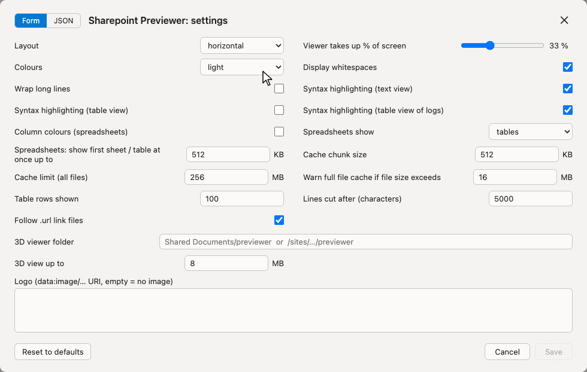
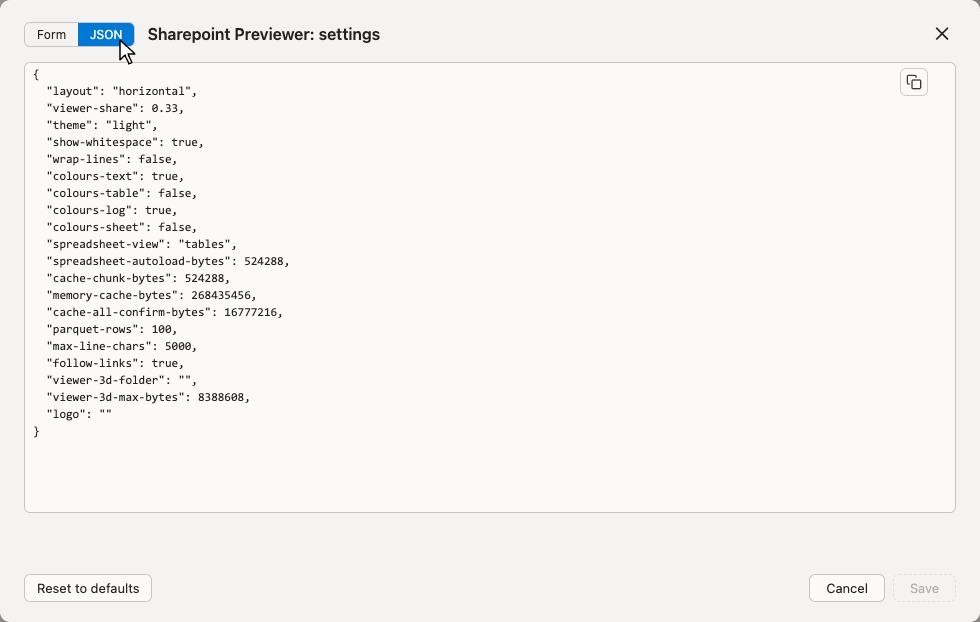
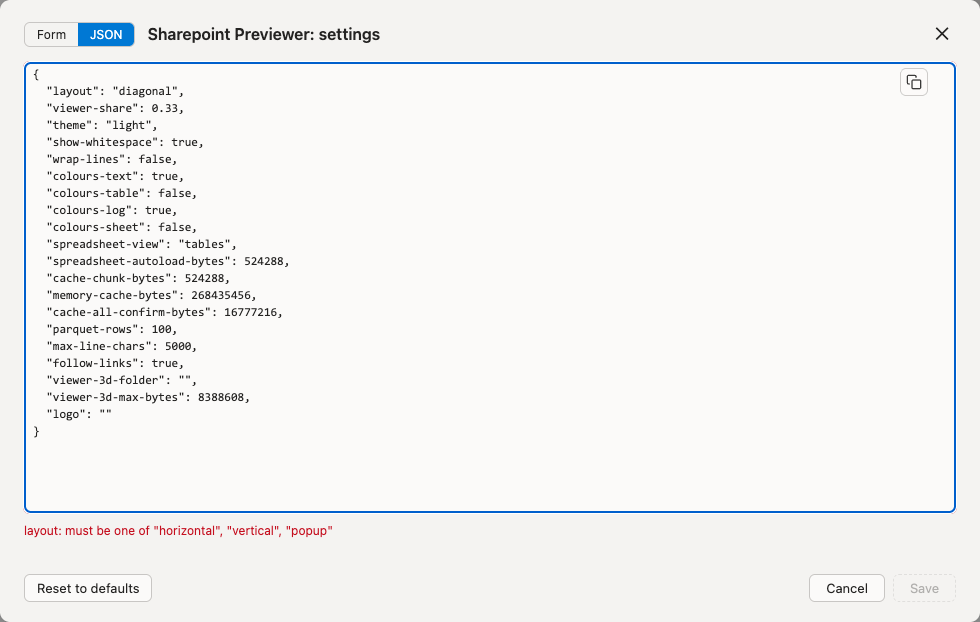

# Demo: Settings #

All screenshots show the mock Sharepoint of the tests
(`/tests/mocks/mock-sharepoint`),
written by `just demos`.
Details: [TECHNICAL.md, Settings](../TECHNICAL.md#settings).

## Opening ##

- Viewer: ⋯ → Full settings …
- Tampermonkey menu: Settings … (also: Reset settings to defaults)

Saved settings apply after a reload of the page.
View choices made in the viewer (layout, colours, ...) are kept as well;
the settings are their start values.

## Form ##

One field per setting.

## JSON ##

The same settings as JSON: to copy (button top right), keep or paste in one go.
Missing settings get their defaults, unknown ones are ignored;
Save writes the completed JSON back.

Values are checked as they are typed;
Save stays disabled until all are valid.

[Back to the demos](README.md)
