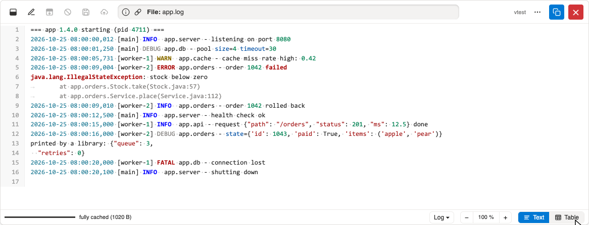
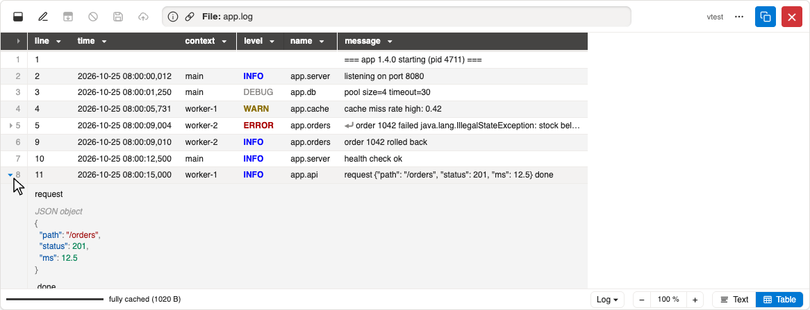

# Demo: Tables and spreadsheets #

All screenshots show the mock Sharepoint of the tests
(`/tests/mocks/mock-sharepoint`),
written by `just demos`.

## CSV ##

CSV and Parquet files open as a table.

Column colours are optional (⋯ → Syntax colours, or the setting `colours-table`).

In edit mode, cells are edited in place (the cell being edited is framed);
delimiter and quote style can be changed for the whole file.

## Spreadsheets ##

Excel (`.xlsx`, `.xlsb`, `.xls`) and OpenDocument (`.ods`) spreadsheets
open sheet by sheet or table by table.

The picker next to **Table** lists all sheets and tables of the file.

## Logs (experimental) ##

Log files open as text, with colours for times, levels, names and values.

**Table** (experimental) guesses the fields from the start of the lines
(time, context, level, name) and shows one row per entry, the message last.
Entries with more in them (a stack trace, a JSON object, a Python dict) have ▸ in their row number.

▸ expands the entry in place:
its message split into text and objects, these indented and coloured
(▸ above the row numbers expands all rows shown).

[Back to the demos](README.md)
