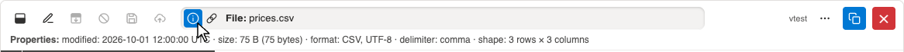

# Demo: Title bar #

All screenshots show the mock Sharepoint of the tests
(`/tests/mocks/mock-sharepoint`),
written by `just demos`.

## Properties ##

The title bar names the file shown.
(i) shows its properties:
dates, size, format, encoding, delimiter, shape.

## Link ##

The chain icon copies the file's link,
clean as a person reads it (not encoded, no query),
e.g. `https://acme.sharepoint.com/sites/MockSharepoint/MockLibrary/Data/prices.csv`.
Without a file open, it copies the folder's link.

## Another name ##

In edit mode, a click on the name (or F2) gives the file another name:
the upload then goes to a new file, the original stays as it is.

[Back to the demos](README.md)
