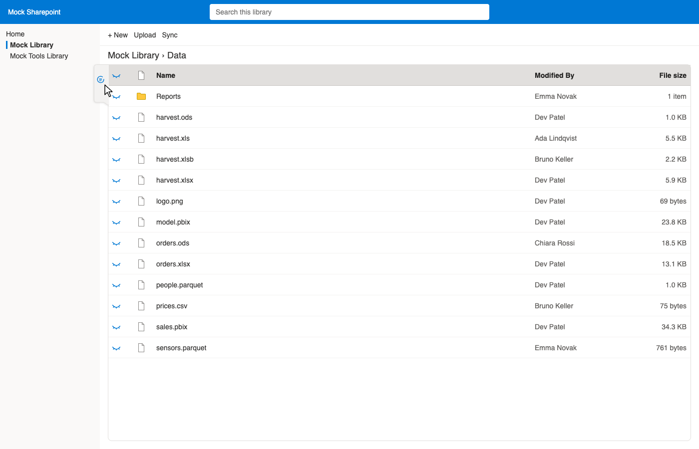
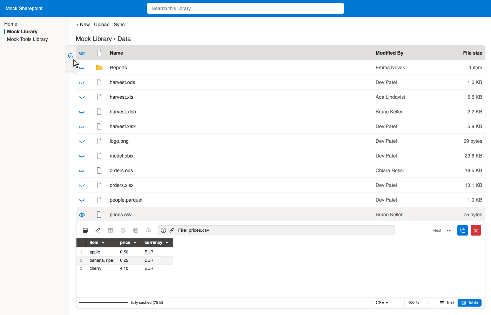
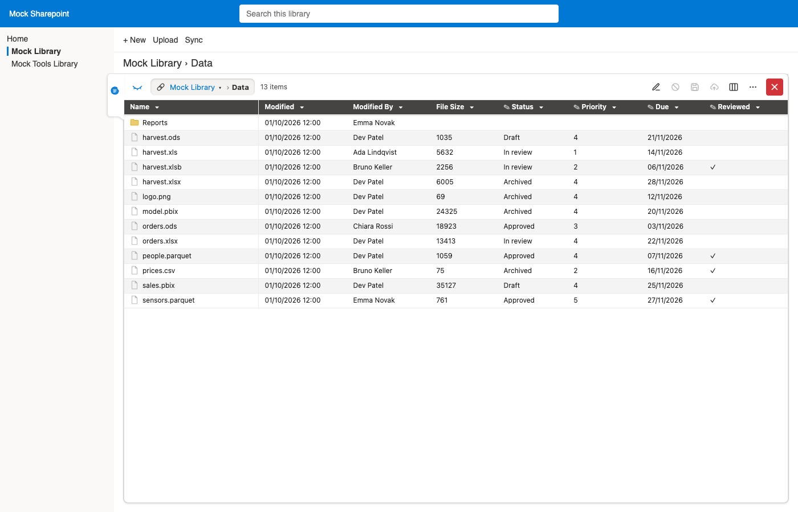
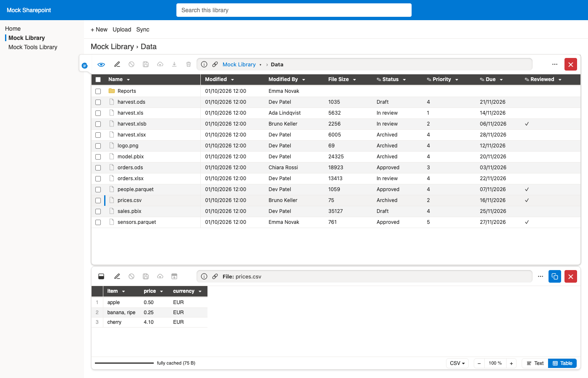
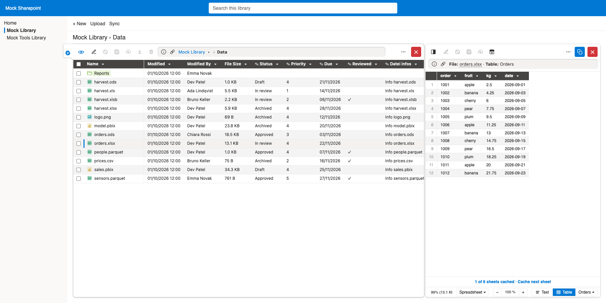
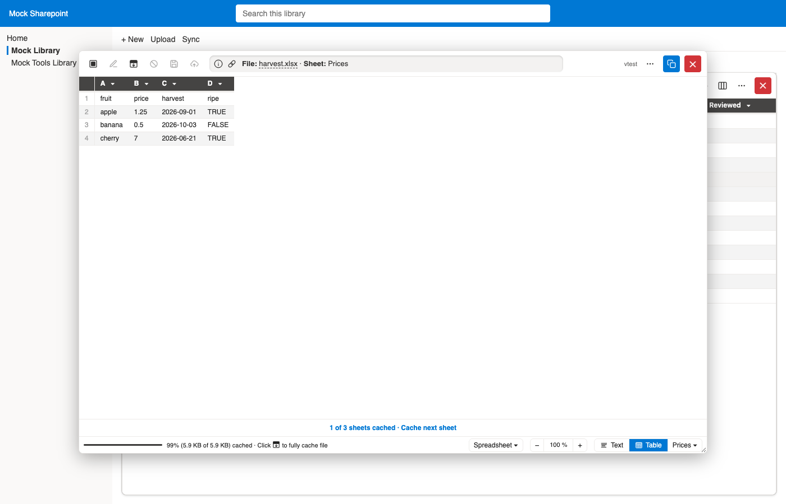
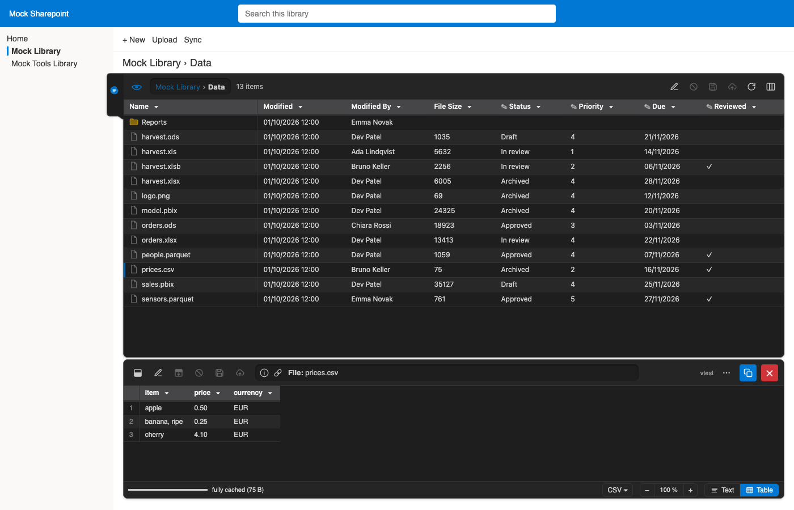
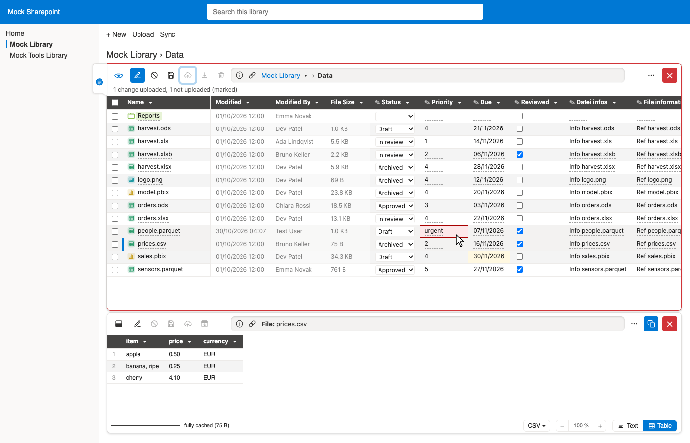

# Demo: Zen mode #

All screenshots show the mock Sharepoint of the tests
(`/tests/mocks/mock-sharepoint`, made-up values),
written by `just demos`.

## Own list ##

Zen mode puts an own list of the folder in place of Sharepoint's,
with or without the viewer (beside it: below or right of it; without it, or under the pop-up: over the full height).
It is switched on and off by the tab out of the left edge of the list (as on a folder; filled while on),
or by ⋯ → Zen mode in the viewer.
The eye at the top left of the Zen list (as on Sharepoint's) opens or closes the viewer;
dragging the edge of the viewer below 20 % of the space closes it too (Zen mode stays).
Zen mode stays on until switched off, also after a page load.

### With and without Zen mode, with and without the viewer ###

| | Without the viewer | With the viewer |
| :- | :- | :- |
| **Zen mode off** (Sharepoint's list; tab: outline) |  |  |
| **Zen mode on** (own list; tab: filled) |  |  |

The tab keeps Sharepoint's colours while Zen mode is off, and takes the theme of the Zen list (light or dark) while it is on.

- The names (left) and the column titles (top) stay in place when scrolling sideways or down.
- Folders come first; a click on a folder opens it in the list, a click on a file shows it in the viewer.
- Sharepoint's list follows to the folder opened (and Back / Forward of the browser work),
  so it shows that folder once Zen mode is off.
- Click a column title to sort (again: descending, again: off); ▾ filters by the values of a column.
- The columns are those of the Sharepoint view at first;
  the columns button (right) shows, hides and orders all columns of the library,
  column titles (and the entries of the menu) can be dragged to move a column, and their right edge sets the width.
  All of it is kept per library (in the browser).
- Sorting, filters and columns change nothing on Sharepoint.

Also right of the list, under the pop-up, and in dark mode:

## Editing ##

The edit button (pencil) of the list makes the cells of non-system columns editable (✎ in their titles):
text, numbers, dates (as Sharepoint shows them), choices, yes / no.
A new name renames the file, as Sharepoint's own rename.
System columns (Modified, Modified By, sizes, …) and people, lookups or terms stay as they are.

As in write mode of the viewer, there are two steps:

- **Save** (or Ctrl / ⌘ + S) keeps the changes in the view (marked amber): nothing changes on Sharepoint yet,
  and they stay when leaving edit mode, the folder or Zen mode, also after a page load.
- **Upload** (cloud) applies them, item by item, as Sharepoint's own form does
  (each value checked by Sharepoint; a new version of the item).
  Values Sharepoint refuses stay marked in red, with its reason as tooltip; the others are applied.

Leaving edit mode before saving is allowed: the changes are kept in the view,
with the note that they take effect only once uploaded (the upload button is marked).
Cancel drops the changes not uploaded (after asking).

> [!NOTE]
> Zen mode uses Sharepoint's REST API (cf. [NOTES.md](../NOTES.md)):
> it is not offered if the setting `sharepoint-api` is off.

[Back to the demos](README.md)
